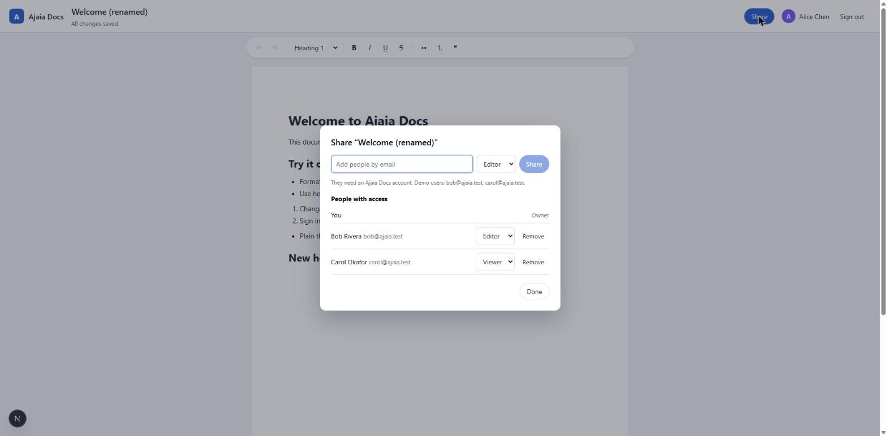

# Ajaia Docs

A lightweight collaborative document editor: create, edit and format documents in the browser, import files, and share them with other users as **editors** or **viewers**.

**Live app:** https://ajaia-docs-hazel-xi.vercel.app (see [Demo accounts](#demo-accounts))
**Walkthrough video:** https://drive.google.com/file/d/19bn-4gQTWb81b7OkwtFbjQN2FpvUaBEc/view?usp=sharing · **Demo GIF (~3 min):** [docs/demo.gif](docs/demo.gif)
**Source:** https://github.com/lumora007/ajaia-docs



## Features

| Area | What works |
| --- | --- |
| Documents | Create, rename (click the title), edit, delete (owner only), reopen. Debounced autosave with a "Saving… / All changes saved / Not saved · Retry" indicator. Ctrl/Cmd+S saves right away. |
| Rich text | Bold, italic, underline, strikethrough, Heading 1–3, bulleted and numbered lists, quotes, undo/redo. Keyboard shortcuts work. |
| File import | Upload **.txt, .md or .docx (max 2 MB)** to create a new document. Headings, bold/italic/underline and lists are kept. Other file types are rejected with a clear message. |
| Sharing | The owner shares by email as **Editor** or **Viewer**, can change roles and remove access. The home page splits **My documents** and **Shared with me** (with owner name and role badge). Viewers get a read-only editor. |
| Auth | Email + password sign-up and sign-in (bcrypt hashes, httpOnly session cookie), plus seeded demo accounts. |
| Persistence | Postgres (Neon in production, embedded PGlite locally). |

## Demo accounts

All use the password **`demo1234`**. The login page also has one-click "Sign in as …" buttons.

| User | Email | Seeded state |
| --- | --- | --- |
| Alice Chen | alice@ajaia.test | Owns "Welcome to Ajaia Docs" |
| Bob Rivera | bob@ajaia.test | Has the welcome doc under *Shared with me* as **editor** |
| Carol Okafor | carol@ajaia.test | Nothing shared yet; use her to test sharing as a viewer |

**Try sharing in 1 minute:** sign in as Alice → open the welcome doc → **Share** → add `carol@ajaia.test` as Viewer → sign out → sign in as Carol → the doc is under *Shared with me* and opens read-only.

Sample files for import are in [samples/](samples/) (`kickoff-brief.docx`, `meeting-notes.md`, `release-checklist.txt`).

## Run locally

Requirements: **Node.js 20.9+** (developed on Node 24). No database setup needed.

```bash
npm install
npm run dev          # http://localhost:3000
```

With no `DATABASE_URL` set, the app uses **PGlite**, an embedded Postgres stored in `./.data/pglite`. Tables and demo data are created on first request. Delete `.data/` to reset.

To use a real Postgres (e.g. Neon) locally, copy `.env.example` to `.env.local` and set `DATABASE_URL`.

| Command | Purpose |
| --- | --- |
| `npm run dev` | Dev server |
| `npm test` | Vitest suite (runs against in-memory Postgres) |
| `npm run typecheck` | TypeScript check |
| `npm run build && npm start` | Production build and server |

## Deploy (Vercel + Neon)

1. Push this repo to GitHub and import it into Vercel (framework: Next.js; defaults are fine).
2. In the Vercel project, open **Storage → Create → Neon Postgres** and connect it. This sets `DATABASE_URL` for all environments. (Or create a database at neon.tech and add `DATABASE_URL` yourself.)
3. Deploy. The schema and demo accounts are created automatically on the first request.

## Project structure

```
app/                 Next.js App Router pages + API route handlers (app/api/**/route.ts)
components/          Client components: DocEditor, Toolbar, ShareDialog, DocList, AuthForm, Header
lib/
  documents.ts       Document + sharing service; getAccess() is the single permission check
  auth.ts            Sign-up, login, DB-backed sessions
  db.ts / schema.ts  Postgres adapter (Neon or PGlite), schema + idempotent seed
  convert.ts         .txt/.md/.docx → HTML import
  sanitize.ts        HTML allowlist applied to every write
  validation.ts      zod schemas
tests/               Vitest: sharing/access control, persistence, auth, import
docs/                Architecture note, AI workflow note, screenshots
```

More detail: [docs/ARCHITECTURE.md](docs/ARCHITECTURE.md) · [docs/AI_WORKFLOW.md](docs/AI_WORKFLOW.md) · [SUBMISSION.md](SUBMISSION.md)
